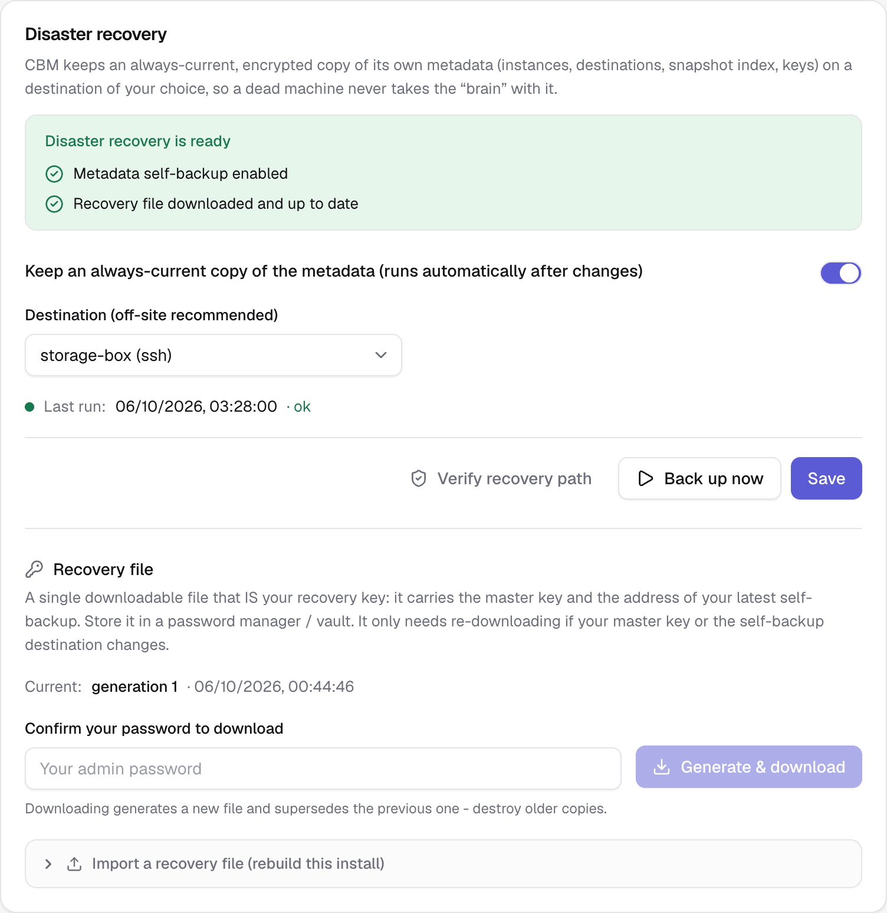

# Disaster recovery

Backing up your resources is only half of "never lose data". The other half is
surviving the loss of the **machine that runs CBM itself** — and being able to
bring everything back on new infrastructure. CBM's disaster-recovery (DR) tools
cover both.

Two things must survive a total loss:

1. **Your backup data** — already off-machine on your destinations (S3 / SSH). Use
   a remote destination, not `local` (a local folder dies with the host).
2. **CBM's own metadata** — which instances/destinations exist, the snapshot
   index, and the keys that decrypt everything. This lives only in the
   controller's database. DR protects it with a **self-backup** + a **recovery
   file**.

> **Run exactly one controller replica.** The scheduler (and the self-backup)
> runs in-process — see [installation.md](installation.md#scaling-run-exactly-one-controller-replica).

---

## 1. Self-backup (always-current metadata copy)

**Settings → Disaster recovery** (admin only). Pick an **off-site** destination
(S3 or remote SSH — `local` destinations aren't offered), turn on the
self-backup switch and **Save**. From then on CBM keeps a single,
encrypted `pg_dump` of its own metadata database on that destination
(`cbm-self-backup/metadata.dump.enc`), overwritten in place:

- **No retention** — recovery always uses the latest, so one artefact is kept.
- **Change-driven + throttled** — it runs shortly after any change (throttled so
  the frequent snapshot writes don't dump every time), plus a **daily** safety
  run.
- **Alerts** — you're notified (via the **Failure alerts** webhook) if the
  self-backup fails or hasn't succeeded in over a day.

**Back up now** runs it immediately; the last run and its status show under the
form. Use **Verify recovery path** to prove it works without a restore: CBM
downloads the latest self-backup and decrypts it, confirming it's a valid,
recoverable dump.

## 2. Recovery file (the bootstrap key)

The self-backup lives on a destination whose credentials are *inside* the very
database you'd be restoring — a chicken-and-egg you break by holding a small
**recovery file** off-machine (a password manager / vault).

**Settings → Disaster recovery → Recovery file** (admin only): pick the kind of file, choose a
**passphrase** (12 characters at least) and type it twice, confirm your password (and your
authenticator code if you use two-factor), then **Generate & download**. The file is downloaded
**once** and never stored on the server. It contains:

- your **master key**,
- the **location + credentials** of the self-backup destination (so a fresh CBM
  can fetch the latest metadata),
- for a **full** file only, a copy of the metadata database as it is now, a fallback for when the
  self-backup can't be reached.

Everything in it is encrypted with the passphrase (scrypt, then AES-256-GCM): the file alone
opens nothing, and without the passphrase nobody can open it - you included. Keep them apart:
the file in a vault or offline copy, the passphrase in a password manager.

| Kind | Size | Use |
| --- | --- | --- |
| **Light** (default) | a few kilobytes | Points to the self-backup, which is always current. Needs the self-backup to be enabled. |
| **Full** | the size of the metadata database, compressed | Also embeds the database at this moment, used when the self-backup can't be downloaded or decrypted. Out of date as soon as things change. |

It only needs re-downloading when the master key, or the self-backup's destination or
credentials change - not after each backup. The page marks the current file *out of date* when
one of these changes (or when it was made before 2.8.0: those held the master key in clear).
Generating a new one supersedes the old - destroy older copies.

> Freshness comes from the **self-backup** (updated continuously), not from
> re-downloading the file. A months-old recovery file still recovers yesterday's
> state, because it points at the latest self-backup.

## 3. Restoring resources onto a fresh Coolify

Every snapshot is **self-describing**: at backup time CBM captures the full
resource definition (git repo/branch/commit, build pack, image, compose,
domains, database image + credentials, environment variables). So a **Clone**
(restore → new) works even when the **source Coolify is gone** — it
reconstructs from the snapshot instead of reading the (dead) source, and it
**creates any missing project/environment** on the target. On a single-server target, every resource
lands on that server automatically; for a multi-server target, set a mapping
from the instance card's "…" menu → **Server mapping for restores** (on
**Coolify instances**).

## 4. Re-point vs migrate

Two complementary ways to send snapshots to a different Coolify (both build on
the captured config above):

- **Re-point an instance** (disaster recovery) — on **Coolify instances**, open
  the instance card's "…" menu → **Re-point the instance** and change the base
  URL + API token to your new, blank Coolify. Every resource, snapshot and
  schedule keeps following that instance. Then re-run the agent install command
  on the new host.
- **Restore onto another instance** (migration) — when several Coolify instances
  are connected, the **Clone** dialog on a snapshot's page offers a **Restore
  onto** select, so you can clone a backup from one Coolify onto another.

---

## End-to-end recovery runbook

Machine (Coolify + CBM) is gone. To fully recover:

1. **New CBM.** `docker compose up -d` a fresh controller — a new `MASTER_KEY` is
   fine (the recovery file carries the old one).
2. **Import the recovery file.** Settings → Disaster recovery → *Import a
   recovery file* (collapsed at the bottom of the section): pick the file, enter
   its passphrase and your password, type `IMPORT`, then **Import & overwrite**
   (on an install that already has instances or destinations, also tick the
   replace box). CBM fetches the latest self-backup from its destination - or,
   when it can't be downloaded or decrypted, uses the copy a full file embeds -
   restores it, and re-encrypts every secret under the new install's master key.
   A file from before 2.8.0 (`.json`) imports too, without a passphrase. You are signed
   out — **sign back in with your OLD credentials** (the imported accounts).
   Two-factor authentication is turned off for every account (its secrets were
   encrypted with the old install's `BETTER_AUTH_SECRET`): set it up again from
   Profile — accounts the policy requires it from are asked at sign-in.
3. **Resume.** An imported install starts **on hold**: no scheduled backup,
   retention, self-backup or alert, so that a test import never acts on
   production. Every page says so; on the install that now replaces production,
   an admin clicks **This install is production now: resume**. Its self-backup
   then takes over the destination.
4. **Re-point the instance** at your new, blank Coolify (instance "…" menu →
   **Re-point the instance**).
5. **Re-install the agent** on the new Coolify host (same per-instance install
   command, from the instance "…" menu → **Install command**). The agent
   auto-detects its server; on a brand-new empty host where it can't yet, set
   the server on the **Agents** page or pass `AGENT_SERVER_UUID` at install (see [multi-server.md](multi-server.md)).
6. *(Multi-server)* set the server map (instance "…" menu → **Server mapping
   for restores**).
7. **Clone** (restore → new) each resource from its snapshot. CBM recreates the
   project/environment, reconstructs the resource from the captured config
   (pinned commit/image), re-injects env + database credentials, and the agent
   restores the data. The source Coolify being dead no longer matters.
8. Verify and deploy.

> **Requirements.** DR needs a **non-`local` destination** for the self-backup,
> and the controller image ships the PostgreSQL client used for the dump/restore.
> After importing and resuming, the self-backup destination is re-used; its next
> run overwrites the artefact under the new master key.

## Test it before you need it

Do a **dry run**: generate a recovery file, stand up a throwaway CBM with a
*different* master key, import the file, and confirm your instances, destinations
and snapshots come back and that a destination still connects. That drill is the
only real proof your recovery works. **Don't resume** the throwaway install: on
hold, it never touches production's self-backup, schedules or webhook.
